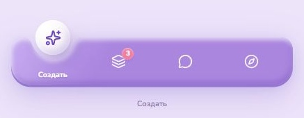

# ClayCraft UI

Дизайн-система и генератор soft 3D claymorphism на React + TypeScript + Vite.

[Открыть демо на GitHub Pages](https://vovanbloger.github.io/Claymorphism-UI/).

Публикация: production-сборка `npm run build`, содержимое `dist/` и `.nojekyll` в ветке `gh-pages`; Pages source — `gh-pages / (root)`. Пути локальных ассетов должны проходить через `resolveClayAssetPath`, чтобы работать в подкаталоге проекта.

## Запуск

```powershell
npm install
npm exec -- vite --host 127.0.0.1 --port 3001
```

Открыть http://127.0.0.1:3001/. API-ключ для текущего интерфейса не нужен. Обычный `npm run dev` использует порт 3000 и все сетевые интерфейсы; команда выше ограничивает доступ этим компьютером.

## Разделы

Библиотека с интерактивными элементами по четырём референсам; генератор React/TSX, CSS и JSON; музыкальный дашборд и логин; визуальная спецификация материала и движения.

Новые типы: status-pills, action-rows, clay-calendar, product-card, workout-card, activity-rings, filter-chips. Их внешняя подложка настраивается генератором; внутренние детали сохраняют семантическую палитру. React-экспорт требует react и lucide-react; CSS сохраняется отдельным файлом reference-clay.css. Демонстрационные состояния не сохраняются после перезагрузки.

## Проверки

```powershell
npm run lint
npm test
npm run build
```

Тесты включают компиляцию семи новых TSX-экспортов. Скриншоты: `output/qa/`. Четыре оригинальных референса: `public/assets/references/`; в библиотеке есть кнопка сравнения.

Подробные заметки для Obsidian: `docs/obsidian/ClayCraft UI/`. Основная база знаний: `D:\Projects\Vault\ClayCraft UI`.

Текущий проект — клиентская демонстрация и генератор. Backend, реальные платежи, авторизация и API генерации изображений не реализованы.

## Нижнее меню из генератора стикеров

В генераторе выберите **Нижнее меню · Sticker Notch**. Живой стенд также доступен в дизайн-системе. Белый медальон перелетает вместе с SVG-выемкой; сохранены исходные формулы `TG_Sticker_Studio/AdaptiveNotchNav` и его чистой библиотеки `notch-math`.

Вариант экспортируется как автономный TSX + CSS + JSON-токены. Нужны `react`, `motion`, `lucide-react`; Telegram/Next.js не нужны. Поддерживаются быстрые переключения, resize, стрелки/Home/End и reduced-motion. Прежний Clay Dock сохранён.


